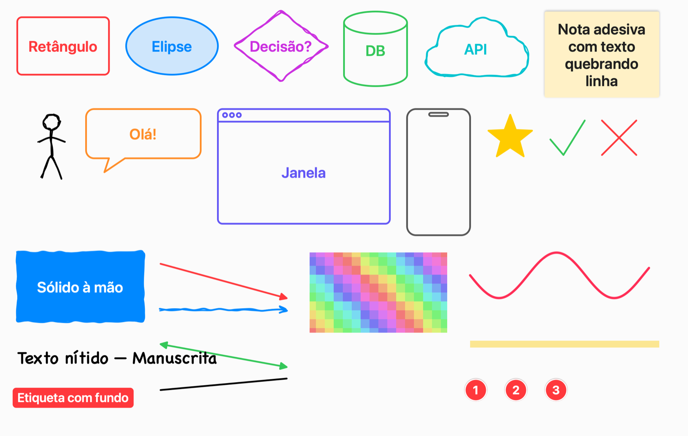

<div align="center">

🇧🇷 [Português](README.md) · 🇺🇸 **English** · 🇪🇸 [Español](README.es.md)

# 📋 CopyPaste

### 100% free · no ads · no sign-up · open source

Developed by **Jonathan Felix** · contact: [jonathansfp@gmail.com](mailto:jonathansfp@gmail.com)

**Clipboard history, annotated screenshots, a presentation board, screen recording and AI voice dictation.**
**For macOS, Windows and Linux: lightweight, fast, free, and nothing running for no reason.**


### 🌐 [Project website](https://jonathansfp.github.io/copypaste/?lang=en) · ⬇️ [Download](#️-download) · 💚 [Donate via Pix](#-support-the-project)



<sub>Everything above is drawn by the app's vector engine: shapes, Excalidraw-style components, freehand strokes, arrows, numbered steps, blur, highlighter and crisp text.</sub>

</div>

---

## ⬇️ Download

Just grab the installer, no code needed:

| System | File | |
|---|---|---|
| 🪟 **Windows 10/11** | [**CopyPaste-Windows-Setup.exe**](https://github.com/jonathansfp/copypaste/releases/latest/download/CopyPaste-Windows-Setup.exe) | Installer (recommended) |
| | [CopyPaste-Windows.msi](https://github.com/jonathansfp/copypaste/releases/latest/download/CopyPaste-Windows.msi) | For businesses / deployment |
| | [CopyPaste-Windows-Portable.zip](https://github.com/jonathansfp/copypaste/releases/latest/download/CopyPaste-Windows-Portable.zip) | Portable, no install |
| 🐧 **Linux** | [**CopyPaste-Linux-x86_64.AppImage**](https://github.com/jonathansfp/copypaste/releases/latest/download/CopyPaste-Linux-x86_64.AppImage) | Any distro: `chmod +x` and run |
| | [CopyPaste-Linux-amd64.deb](https://github.com/jonathansfp/copypaste/releases/latest/download/CopyPaste-Linux-amd64.deb) | Ubuntu, Debian, Mint, Pop!_OS |
| | [CopyPaste-Linux-x86_64.rpm](https://github.com/jonathansfp/copypaste/releases/latest/download/CopyPaste-Linux-x86_64.rpm) | Fedora, openSUSE |
| 🍎 **macOS 14+** | [**CopyPaste-macOS.dmg**](https://github.com/jonathansfp/copypaste/releases/latest/download/CopyPaste-macOS.dmg) | Apple Silicon and Intel |
| | [CopyPaste-macOS.zip](https://github.com/jonathansfp/copypaste/releases/latest/download/CopyPaste-macOS.zip) | The same app, zipped |

All versions are in [**Releases**](https://github.com/jonathansfp/copypaste/releases). The files are built automatically by GitHub Actions from this code.

> **Opening it for the first time?** The app isn't signed through a store, so the system asks for confirmation once:
> **Windows:** "Windows protected your PC" → *More info* → *Run anyway*.
> **macOS:** right-click the app → *Open* → *Open* (or `xattr -dr com.apple.quarantine /Applications/CopyPaste.app`).
> **Linux (AppImage):** `chmod +x CopyPaste-Linux-x86_64.AppImage && ./CopyPaste-Linux-x86_64.AppImage`.

---

## 💚 Support the project

CopyPaste is **free and open source**. If it saves you time, consider a donation via **Pix**, Brazil's instant payment system (available in any Brazilian bank app). Any amount helps keep the project alive and bring new features.

<table><tr><td>

**Pix key (random)**

```
586cb2d1-8a6e-4bed-8cdb-1f413e8f3e38
```

</td></tr></table>

In your bank app: **Pix → Pagar → Chave aleatória** (Pix → Pay → Random key) and paste the key. The option is also inside the app: **menu bar icon → Donate via Pix ♥** (copies the key).

---

## 🗂️ Repository structure

Each system has its own folder. The Mac uses a 100% native Swift app; Windows and Linux share a Rust core, with each system's specific code in its own folder.

```
copypaste/
├── macos/     🍎 Native Mac app (Swift, AppKit + SwiftUI, ScreenCaptureKit) — build.sh, package.sh
├── windows/   🪟 Native Windows code (Rust: paste via SendInput, Windows OCR, window hidden from recordings) — build.ps1
├── linux/     🐧 Native Linux code (Rust: X11/Wayland, xdotool/wtype, Tesseract, PulseAudio/PipeWire) — build.sh
├── core/      ⚙️ Shared Windows and Linux core (Tauri 2: Rust + GPU-accelerated canvas UI)
├── docs/      Project website (GitHub Pages) and README images
└── .github/workflows/release.yml   Builds and publishes the installers for all three systems
```

| | macOS | Windows | Linux |
|---|---|---|---|
| Clipboard history with search and filters | ✅ | ✅ | ✅ |
| Paste into the previous app (Enter / double-click) | ✅ | ✅ | ✅ (X11: xdotool · Wayland: wtype/ydotool) |
| Frozen capture, magnifier, window highlighting | ✅ | ✅ | ✅ |
| Annotations (arrows, shapes, crisp text, steps, blur, highlighter) | ✅ | ✅ | ✅ |
| Pin capture to screen | ✅ | ✅ | ✅ |
| Copy text from images (OCR) | ✅ Vision | ✅ Windows OCR | ✅ Tesseract |
| Excalidraw-style presentation board + laser | ✅ | ✅ | ✅ |
| MP4 screen recording + microphone + system audio | ✅ | ✅ (ffmpeg) | ✅ (ffmpeg) |
| Voice dictation with local AI (Gemma 4, offline) or your own (Claude, GPT, Gemini, DeepSeek, Grok) | ✅ (+ Apple transcription) | ✅ | ✅ |
| Weekly new-version notice | ✅ | ✅ | ✅ |
| Voice command on the selected text | ✅ | ✅ | ✅ (X11: xdotool · Wayland: wtype/ydotool) |
| Customizable global shortcuts | ✅ | ✅ | ✅ (Wayland: system shortcut → `copypaste --capture-area`) |

Details for each system: [`macos/`](macos/README.md) · [`windows/`](windows/README.md) · [`linux/`](linux/README.md) · [`core/`](core/README.md).

---

## Contents

- [Download](#️-download)
- [Support the project](#-support-the-project)
- [Repository structure](#️-repository-structure)
- [Why CopyPaste?](#why-copypaste)
  - [The Mac pain points CopyPaste solves](#-the-mac-pain-points-copypaste-solves)
- [Features](#features)
  - [Clipboard history](#-clipboard-history)
  - [Screenshots](#-screenshots)
  - [Presentation mode (board)](#-presentation-mode-board)
  - [Screen recording](#-screen-recording)
  - [AI voice dictation](#️-ai-voice-dictation)
- [Shortcuts](#shortcuts)
- [Windows and Linux](#-windows-and-linux)
- [Installing on Mac](#installing-on-mac)
- [Permissions](#permissions)
- [Building from source](#building-from-source)
- [Architecture](#architecture)
- [Performance and memory](#performance-and-memory)
- [Privacy](#privacy)
- [Troubleshooting](#troubleshooting)
- [License](#license)

---

## Why CopyPaste?

The Mac is excellent, but plenty of everyday tasks **simply don't exist in macOS**, or require three different apps, paid subscriptions and lots of clicks. CopyPaste brings all of it into a single app that is **native, free, offline and lightweight**, with the quality of a professional tool.

### 🩹 The Mac pain points CopyPaste solves

| # | The pain on macOS | How CopyPaste solves it |
|:-:|---|---|
| 1 | **The Mac only remembers the last thing you copied.** Copy something else and the previous item is gone for good. | **Clipboard history** with text, links, code, colors, images and files, search, pins and paste right at the cursor (`⇧⌘V`). |
| 2 | **Annotating a screenshot is a ritual:** `⇧⌘4`, wait for the thumbnail, open Markup, edit, save, hunt for the file. | **Annotate in place, instantly**: arrow, text, highlight, numbered steps and blur right on the selection, and `↩` copies. No extra windows. |
| 3 | **The Desktop becomes a dump of "Screenshot 2026-…png".** | By default, captures go **to the clipboard**. Save only when you want to, in a dedicated folder (`~/Pictures/CopyPaste`), as PNG or JPG. |
| 4 | **Hiding passwords, emails or client data** in a screenshot takes another editor. | **Blur / hide** tool (`B`), which pixelates the area into large blocks in the final file itself (not a removable layer on top). |
| 5 | **Copying text from an image, a video or an app that won't let you select it** is painful. | **Offline OCR** (`⌘T`): select any area of the screen and the text goes to the clipboard. |
| 6 | **Finding the exact color of a pixel** takes the hidden "Digital Color Meter". | **Magnifier with an eyedropper** right in the capture: `C` copies the color as hex (`#1E90FF`). |
| 7 | **You need a reference on screen** (a layout, a code snippet, a table) while working in another window. | **Pin to screen**: the capture becomes a small floating window above everything, with adjustable transparency. |
| 8 | **You can't draw on the screen** during a meeting, class or recording to point things out and explain. | **Presentation mode**: pen, arrows, laser and components over any app, with a mode that lets clicks pass through to the apps below. |
| 9 | **Sketching an idea or a quick diagram** means opening a browser or another app. | **Instant board** (white, grid, dark or chalkboard) with Excalidraw-style components: notes, databases, people, clouds, windows, phones and freehand strokes. |
| 10 | **The built-in recorder (`⇧⌘5`) doesn't record the Mac's audio**, only the microphone. Recording a class or tutorial with the video's sound becomes a hack. | **Records screen + microphone + Mac audio together**, with highlighted clicks, for an area or the full screen, hardware-encoded. |
| 11 | **System capture shortcuts are fixed and hard to remember** (`⇧⌘3`, `⇧⌘4`, `⇧⌘4` + `Space`, `⇧⌘5`…). | **Every shortcut is customizable**, even single F keys (like the Print Screen key on external keyboards), with conflict warnings. |
| 12 | **The alternatives are heavy, slow or paid:** Electron apps that hang when opening, or monthly subscriptions. | **100% native Swift**, no dependencies, ~50 MB at rest, opens a capture in ~150 ms. **Free and open source.** |
| 13 | **Clipboard managers can store your passwords.** | **Automatically ignores** whatever 1Password, KeeWeb and others mark as confidential. Nothing leaves your Mac. |

### ⚖️ Compared to common screenshot tools

Tools like Lightshot tend to be **slow to open**, leave **blurry text** and have few tools. See the difference:

| | Common tools | **CopyPaste** |
|---|---|---|
| Opening a capture | Slow, sometimes freezes | **The screen freezes instantly** (~150 ms with 2 displays) |
| Sharpness | Rasterized annotations | **Vectors** drawn at Retina resolution |
| Tools | Pen, arrow, rectangle | + highlighter, numbered steps, blur, text with background, **components**, freehand strokes, laser |
| Windows | Manual selection | **Highlights the window under the mouse**; one click captures just that window |
| Precision | No magnifier | **Magnifier** with coordinates and pixel color (copies the hex) |
| Text from images | — | Offline **OCR** |
| After capturing | Copy / save | + **pin to screen**, **open on the board**, **record the area**, Google Lens |
| Presentation | — | **Board** over the screen or on a white, grid, dark or chalkboard background |
| Video | — | Screen **recording** with microphone and Mac audio |
| Shortcuts | Fixed | **All customizable**, with conflict warnings |
| Resource use | Always-running process | **Nothing runs in the background**: everything is created on demand and released when closed |

---

## Features

### 📋 Clipboard history

- Saves copied **text, links, code, colors, images and files**, with the icon of the app they came from.
- **Quick panel** (`⇧⌘V`) that opens next to the text cursor, the mouse pointer or in the center of the screen.
- **Pastes directly** where the cursor is (with the Accessibility permission) or just copies.
- Full **library** with search, filters by type, pinned and most used items.
- **Pinned** items never expire. You can choose how long to keep items (from 1 hour to forever) and an item limit.
- **Ignores password managers**: content marked as confidential (1Password, KeeWeb, etc.) is never saved.
- Recognizes colors (`#FF8800`, `rgb(…)`) and shows a swatch; detects code from the content and the source app.

### 📸 Screenshots

1. Press the shortcut and **the screen freezes immediately**, on every display.
2. **Hover** over a window to highlight it, and **click** to capture it. Or **drag** to choose an area.
3. Annotate, then **copy** (`↩`), **save** (`⌘S`) or choose another action.

**Precise selection**
- Magnifier with pixel zoom, coordinates and color (`C` copies the color as hexadecimal).
- Arrow keys move the pointer 1 pixel at a time.
- `⇧` makes the selection square, `F` or `↩` selects the full screen.
- After selecting: handles to resize, `⌘` + drag to move the area (annotations move with it).
- The real size in pixels is always shown above the selection.

**Annotation tools**

| Tool | Key | Tool | Key |
|---|:-:|---|:-:|
| Select / move / resize | `V` | Text (with or without background) | `T` |
| Pen | `P` | Numbered step ①②③ | `N` |
| Highlighter | `H` | Blur / hide data | `B` |
| Line | `L` | Eraser | `E` |
| Arrow | `A` | Sticky note | `S` |
| Rectangle | `R` | Diamond | `D` |
| Ellipse | `O` | Laser (presentation) | `K` |

**Style:** 12 colors (`1`–`9` switch quickly), 4 stroke widths, fill (none, soft or solid), dashed lines, **hand-drawn strokes** and 5 fonts (System, Rounded, Handwritten, Serif, Code) with adjustable size.

**Editing:** unlimited undo and redo, `⌥` + drag duplicates, `⇧` constrains lines to 45° and shapes to squares or circles, arrow keys move the selected item and double-click edits text.

**Actions after capturing**

| Action | Shortcut |
|---|:-:|
| Copy | `↩` · `⌘C` · double-click |
| Save to the configured folder | `⌘S` |
| Save as… | `⇧⌘S` |
| Copy the text from the image (OCR, offline) | `⌘T` |
| Search the image with Google Lens | — |
| **Pin to screen** (stays above windows; scrolling adjusts transparency) | — |
| **Open on the** presentation **board** | — |
| **Record video** of this area | — |

### 🎨 Presentation mode (board)

Draw **over anything on the screen** during a meeting, class or recording, or use a blank board.

- **Backgrounds:** transparent over the screen, whiteboard, grid, dark and green chalkboard (`G` cycles).
- **Excalidraw-style components:** sticky note, database, person, cloud, speech bubble, browser window, phone, star, check and cross, double arrow, plus rectangle, ellipse and diamond.
- **Text inside components:** double-click any shape to write inside it, centered and with line wrapping.
- **Laser:** a red stroke that fades on its own, for pointing without cluttering the board.
- **Interact mode (`I`):** clicks pass through to the apps below and the drawing stays visible. Go back to drawing with the board shortcut or the pill at the top of the screen.
- **Paste (`⌘V`):** images and text from the clipboard become board items.
- **Export and share:** buttons right on the toolbar to **copy** (paste straight into WhatsApp, Teams, Slack or email), **save** and, on Mac, **share** via AirDrop, Messages or Mail (`⇧⌘E`). The ⋯ menu has save as and pin to screen. With a transparent background, the export includes what was on screen, in Retina.
- The drawing **is kept** when you close the board, until you clear it.
- **Movable toolbar:** drag it by the handle (☰) anywhere. Drop it on a side and it becomes **vertical**; near the top or bottom, horizontal. It never sits behind the camera notch and remembers its position (double-click the handle to reset).

### 🎬 Screen recording

- Record an **area** or the **full screen**. Click a window to record just its region.
- **Microphone** and **Mac audio** (app sounds), each with its own button.
- **Mouse click highlighting**; 24, 30 or 60 frames per second.
- **Hardware** encoding (H.264 via ScreenCaptureKit), with low CPU usage.
- A red frame marks the recorded area and **doesn't appear in the video**. Board drawings **do appear**, which is handy for recording classes and tutorials.
- While recording, the menu bar icon turns red with a timer. To stop, use the same shortcut or the menu.
- The video is saved to `~/Movies/CopyPaste` and Finder opens showing the file.

> Recording requires **macOS 15** or later. All other features run on macOS 14 and up.

### 🎙️ AI voice dictation

Speak instead of typing, **in any app**: hold the shortcut, speak and let go. The text appears at the cursor, already **without "um", "uh", "like", with punctuation, accents and lists**, and with your self-corrections applied ("at three, no, I mean, at four" becomes "at four").

- **Hold and speak** (`⌥Space` on Mac, `Ctrl+Shift+Space` on Windows and Linux), or **tap once** to keep listening and tap again to finish. `Esc` or the ✕ cancels.
- **Voice command** (`⌥⇧Space` / `Ctrl+Alt+Space`): select some text and say what to do, like "translate to Spanish", "make it more formal" or "summarize in three bullet points". The result replaces the selection. With no selection, the AI writes whatever you ask for.
- **Local AI, default and free:** Google's **Gemma 4 E2B** runs on your computer via [llama.cpp](https://github.com/ggml-org/llama.cpp), with no internet and no key. It transcribes your voice and polishes the text. It's downloaded once in **Settings** (about 4 GB), with pinned versions verified by SHA-256, and frees its memory after 10 minutes of inactivity. It's the AI used when no other is active.
- **Or use your own AI.** Connect your API key in **Settings**: **Claude** (Anthropic), **ChatGPT** (OpenAI), **Gemini** (Google), **DeepSeek** or **Grok** (xAI). Choose the model for each; the app already suggests a fast one (for Gemini, `gemini-flash-latest`).
- **Transcription:** local AI (all systems), **Apple** (Mac, free and on-device), **OpenAI** or **Gemini** (with your key).
- **Styles:** natural, formal (emails), casual (chats) or verbatim (transcription only, no AI). On Mac, the tone adapts to the app in use.
- **Vocabulary:** add names, acronyms and technical terms so they come out spelled right.
- A discreet pill at the bottom of the screen shows your voice level and progress, and **doesn't appear in screenshots or recordings**.

> 🔑 **No server and no monthly fee:** CopyPaste charges nothing for the AI. The key is stored in the Mac's **Keychain** (on Windows and Linux, in a file only you can access in the settings folder), and the audio and text go straight from your computer to the AI you chose, billed to your account there, usually pennies a month.

---

## Shortcuts

### Global (customizable)

In **Settings › Global shortcuts**: click the shortcut and press the new combination. `⌫` disables it and `↺` restores the default. Single F keys (F13–F20, like the **Print Screen** key on external keyboards) work too. If the combination already belongs to another action, the app warns you and disables the other one.

| Action | Default |
|---|:-:|
| Open clipboard history | `⇧⌘V` |
| Capture area or window | `⇧⌘1` |
| Capture full screen | `⇧⌘2` |
| Presentation mode (board) | `⌥⇧⌘D` |
| Record screen (start / stop) | `⌥⇧⌘R` |
| Voice dictation (hold or tap) | `⌥Space` |
| Voice command on the selected text | `⌥⇧Space` |

> 💡 **Coming from Lightshot?** Set area capture to `F13`, the same key it uses.
> ⚠️ Global shortcuts apply in **all** apps. Avoid combinations like `⌘G` or `⌘F`, which would take "Find" away from other programs.

### In the history panel

| Key | Action |
|---|---|
| `↑` `↓` | Navigate |
| `↩` or double-click | Paste at the cursor |
| `⌘↩` or `⌘C` | Copy only |
| `⌘1` … `⌘9` | Paste the item at that position |
| `Space` | Preview |
| `⇥` / `⇧⇥` | Switch filter |
| `⌘P` | Pin / unpin |
| `⌘⌫` | Delete item |
| `⌘L` | Open the library |
| `⎋` | Close |

### In captures and on the board

| Key | Action |
|---|---|
| `V P H L A R O D T N S B E K` | Tools |
| `1` … `9` | Change color |
| `⌘Z` / `⇧⌘Z` | Undo / redo |
| `⌫` | Delete the selected item |
| `⌘D` · `⌥` + drag | Duplicate |
| `⌘A` | Select all |
| `⇧` while dragging | 45°, square, circle |
| `⎋` | Deselect · close |
| `G` · `I` · `F` (board) | Background · interact with the screen · bring to front |

---

## 🪟🐧 Windows and Linux

The same features, with the same focus on quality: the screen freezes the moment you hit the shortcut, annotations are vectors rendered at the display's **native resolution** (crisp text and arrows on 4K screens at 150%/200% scaling) and the UI runs on a GPU-accelerated canvas.

**Default shortcuts** (all customizable in *Settings › Shortcuts*):

| Shortcut | Action |
|---|---|
| `Win` `Alt` `V` | Clipboard history (on Windows; on Linux, `Ctrl` `Shift` `V`) |
| `PrtSc` | Capture area or window (like Lightshot) |
| `Shift` `PrtSc` | Capture the full screen |
| `Ctrl` `Shift` `D` | Presentation mode (board) |
| `Ctrl` `Shift` `R` | Record the screen (again to stop) |
| `Ctrl` `Shift` `Space` | Voice dictation (hold and speak, or tap) |
| `Ctrl` `Alt` `Space` | Voice command on the selected text |

> **Windows 11:** if `PrtSc` opens the system's Snipping Tool, turn it off in *Settings › Accessibility › Keyboard › "Use the Print screen key to open screen capture"*, or choose another shortcut.

**Optional extras:**

| For | Windows | Linux |
|---|---|---|
| Screen recording | `winget install Gyan.FFmpeg` | `sudo apt install ffmpeg` |
| Auto-paste | (built in) | `sudo apt install xdotool` (X11) · `wtype` or `ydotool` (Wayland) |
| OCR | (built in, Windows OCR) | `sudo apt install tesseract-ocr` (add `tesseract-ocr-por` / `tesseract-ocr-spa` for Portuguese / Spanish) |
| System audio | Enable "Stereo Mix" in the sound settings | `pulseaudio-utils` (pactl) |

**Wayland (GNOME/KDE):** if a global shortcut doesn't respond, create a system shortcut that runs `copypaste --capture-area` (or `--capture-screen`, `--history`, `--board`, `--record`). The running app picks up the command instantly.

**Data:** history and settings live in `%APPDATA%\io.github.jonathansfp.copypaste` (Windows) or `~/.local/share/io.github.jonathansfp.copypaste` and `~/.config/io.github.jonathansfp.copypaste` (Linux). Nothing leaves your computer.

**Building:** see [`windows/README.md`](windows/README.md) and [`linux/README.md`](linux/README.md).

---

## Installing on Mac

### From the `.dmg`

1. Download [`CopyPaste-macOS.dmg`](https://github.com/jonathansfp/copypaste/releases/latest/download/CopyPaste-macOS.dmg) or build it with `cd macos && ./package.sh` (creates `macos/dist/CopyPaste-<version>.dmg` and a `.zip`).
2. Drag **CopyPaste** to **Applications**.
3. The first time, right-click the app, then click **Open** and **Open** again. If it says "is damaged":
   ```bash
   xattr -dr com.apple.quarantine /Applications/CopyPaste.app
   ```

### Straight from the source

```bash
git clone https://github.com/jonathansfp/copypaste.git
cd copypaste/macos
./install.sh   # builds, installs to /Applications and launches
```

CopyPaste lives **only in the menu bar**, with no Dock icon. On first launch it opens the settings and starts automatically with the Mac from then on.

---

## Permissions

| Permission | What for | Where to allow it |
|---|---|---|
| **Accessibility** | Auto-paste at the cursor | System Settings › Privacy & Security › Accessibility |
| **Screen & System Audio Recording** | Capture and record the screen | System Settings › Privacy & Security › Screen Recording |
| **Microphone** | Voice dictation and recording your voice along with the screen | macOS asks on first use |
| **Speech Recognition** | Apple's on-device transcription (dictation) | macOS asks on first dictation |

The status of each permission is shown in **Settings**, with buttons that take you straight to the right place.

> After allowing Screen Recording, **quit and reopen CopyPaste**: macOS only applies the permission to the reopened app.

---

## Building from source

**Requirements:** macOS 14+, Xcode 15+ (SwiftUI macros need the full Xcode, not just the Command Line Tools).

```bash
cd macos
./build.sh     # builds build/CopyPaste.app (universal: Apple Silicon + Intel)
./install.sh   # builds, installs to /Applications and launches
./package.sh   # builds dist/CopyPaste-<version>.dmg and .zip
```

`build.sh` uses Xcode even if `xcode-select` points to the Command Line Tools.

### Signing (important for permissions)

macOS ties privacy permissions to the app's **signature**:

- With an **Apple Development** or **Developer ID** certificate in the Keychain (Xcode creates one when you sign in with your Apple account), `build.sh` signs with it automatically. That way **permissions keep working after rebuilding**.
- Without a certificate, the app is only signed locally ("ad-hoc"), and macOS **asks for permissions again after every build**.
- To choose the identity: `SIGN_IDENTITY="Developer ID Application: …" ./build.sh`.

### Drawing self-test

```bash
macos/build/CopyPaste.app/Contents/MacOS/CopyPaste --selftest /tmp/test.png
```

Draws every shape and style into a PNG and checks hit detection and undo/redo. The image at the top of this README is generated this way.

---

## Architecture

**Mac:** 100% native **Swift** app, with **AppKit + SwiftUI** and no external dependencies. It only uses system frameworks:
**ScreenCaptureKit** (capture and recording), **CoreGraphics / CoreImage** (drawing and blur), **Vision** (OCR), **Carbon** (global shortcuts, no Accessibility needed) and **ServiceManagement** (launch at login).

```
macos/Sources/CopyPaste/
├── main.swift, AppDelegate.swift      # Lifecycle, menu bar menu, windows
├── HotKeyManager.swift                # Global shortcuts (Carbon) per action
├── Settings.swift, SettingsView.swift # Preferences and settings screen
├── ClipboardStore.swift, ClipItem.swift, QuickPanel.swift, LibraryView.swift, PasteService.swift
│                                      # Clipboard history, quick panel, library, paste
├── Canvas/                            # Vector drawing engine (capture + board)
│   ├── Shapes.swift                   #   Shapes, styles, rendering, hand-drawn strokes
│   ├── CanvasModel.swift              #   State, selection, undo/redo
│   ├── CanvasView.swift               #   Interaction: create, move, resize, edit text, laser
│   └── CanvasUI.swift                 #   Toolbars and style panel (SwiftUI)
├── Capture/                           # Screen capture
│   ├── ScreenGrabber.swift            #   Freezing via ScreenCaptureKit, windows, export
│   ├── CaptureController.swift        #   Selection, magnifier, handles, toolbars, final rendering
│   └── CaptureExtras.swift            #   Quick notice (toast), OCR, pinned window
├── Board/BoardController.swift        # Presentation mode / board
├── Recording/ScreenRecorder.swift     # Screen + audio recording
├── Diag.swift                         # Diagnostic log and --diagnose
└── SelfTest.swift                     # --selftest
```

**Windows and Linux:** **Rust** core with **Tauri 2** (lightweight windows using the system WebView, no Electron). Capture uses the `xcap` library (DXGI on Windows; X11/PipeWire on Linux), the clipboard uses `arboard` and global shortcuts use `global-hotkey`. Drawing uses the same vector engine as the Mac, ported to a GPU-accelerated canvas. See [`core/README.md`](core/README.md).

**How capture works (Mac)**
1. The shortcut triggers `CaptureController`, which asks ScreenCaptureKit for an image of each display, at Retina resolution and without the cursor.
2. Each display gets a borderless window that shows the frozen image in a GPU layer. On top of it sits `CaptureCanvasView`, which draws the dimming, the selection and the annotations.
3. Annotations are **vectors** (`Shape`). When copying or saving, the crop of the original image is combined with the shapes drawn at the real pixel resolution, which is why text and arrows stay perfectly crisp.
4. On close, windows, images and the model are released.

---

## Performance and memory

- **At rest:** ~50 MB. Only the clipboard monitor runs, a light check every 0.4 s.
- **Capture:** opens in ~150 ms with 2 Retina displays. Memory goes up while it's open (screens are kept at full resolution) and is returned on close, with no leaks across repeated captures.
- **Drawing:** only the shapes are redrawn on each movement; the frozen image stays in a GPU layer.
- **Recording:** hardware encoding, with no frame copying by the app.

---

## Privacy

- **Nothing leaves your Mac.** There's no telemetry and no account. OCR runs locally through Vision.
- **Updates:** once a week the app checks GitHub's releases page; if there's a new version, it asks whether you want to update. When you click **Update now**, the app downloads the new version, installs it and reopens on its own (on Linux, in the AppImage; .deb and .rpm open the download page). Nothing is sent beyond that check.
- **Voice dictation:** with the local AI or Apple's transcription, everything stays on your computer. When you connect an AI, only the dictation audio and text go, straight from your Mac, to the provider **you** chose, with **your** key. There's no CopyPaste server in between.
- History is stored in `~/Library/Application Support/CopyPaste/`.
- Content marked as confidential by password managers **is never saved**.
- The only action that opens something on the internet is **Search with Google Lens**, and only when you click it: it opens the browser and the image is copied for you to paste.

---

## Troubleshooting

<details>
<summary><b>The capture shortcut does nothing, or the app keeps asking to "Open Settings"</b></summary>

It's almost always the **Screen Recording** permission tied to an old signature of the app (it shows as enabled in Settings, but macOS denies it). To fix it:

```bash
tccutil reset ScreenCapture local.copypaste.app
tccutil reset AudioCapture local.copypaste.app
```

Then quit and reopen CopyPaste, press the shortcut, allow it when macOS asks and click **Quit & Reopen**. To keep this from happening again, build with a stable certificate (see [Signing](#signing-important-for-permissions)).
</details>

<details>
<summary><b>The shortcut shows in red ("already used by another app")</b></summary>

Another program registered the same combination (for example, Lightshot with `F13`). Quit the other app or choose another combination in Settings.
</details>

<details>
<summary><b>It doesn't paste on its own, it only copies</b></summary>

Allow CopyPaste in **System Settings › Privacy & Security › Accessibility**.
</details>

<details>
<summary><b>How can I see what's happening inside?</b></summary>

The app keeps a short log (up to ~200 KB) at:

```
~/Library/Application Support/CopyPaste/diagnostico.log
```

It records the shortcuts (whether they were registered and when they fired), the permission status and capture or recording errors. To test just the permission and capture:

```bash
open -n /Applications/CopyPaste.app --args --diagnose
# and to also save an image of the main screen:
open -n /Applications/CopyPaste.app --args --diagnose --save /tmp/screen.png
```
</details>

---

## License

Distributed under the **GNU GPL v3.0** license. See [`LICENSE`](LICENSE).

<div align="center"><sub>Made with Swift and Rust, for people who copy, capture and explain things all day long. 💚 Pix: <code>586cb2d1-8a6e-4bed-8cdb-1f413e8f3e38</code></sub></div>
