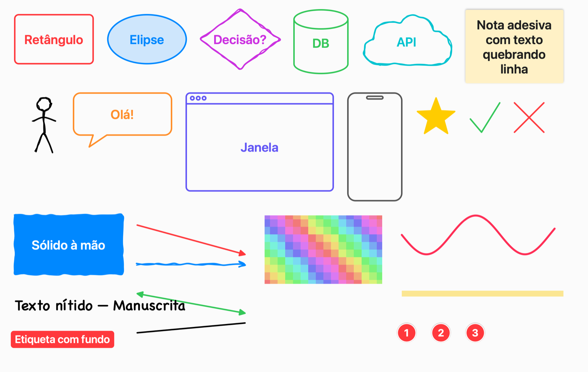

<div align="center">

🇧🇷 [Português](README.md) · 🇺🇸 [English](README.en.md) · 🇪🇸 **Español**

# 📋 CopyPaste

### 100% gratis · sin anuncios · sin registro · código abierto

Desarrollado por **Jonathan Felix** · contacto: [jonathansfp@gmail.com](mailto:jonathansfp@gmail.com)

**Historial del portapapeles, capturas de pantalla con anotaciones, pizarra de presentación, grabación de pantalla y dictado por voz con IA.**
**Para macOS, Windows y Linux: ligera, rápida, gratis y sin nada ejecutándose porque sí.**


### 🌐 [Sitio del proyecto](https://jonathansfp.github.io/copypaste/?lang=es) · ⬇️ [Descargar](#️-descarga) · 💚 [Donar con Pix](#-apoya-el-proyecto)



<sub>Todo lo que ves arriba lo dibuja el motor vectorial de la app: formas, componentes al estilo Excalidraw, trazo a mano, flechas, pasos numerados, desenfoque, resaltador y texto nítido.</sub>

</div>

---

## ⬇️ Descarga

Descarga solo el instalador, sin necesidad del código:

| Sistema | Archivo | |
|---|---|---|
| 🪟 **Windows 10/11** | [**CopyPaste-Windows-Setup.exe**](https://github.com/jonathansfp/copypaste/releases/latest/download/CopyPaste-Windows-Setup.exe) | Instalador (recomendado) |
| | [CopyPaste-Windows.msi](https://github.com/jonathansfp/copypaste/releases/latest/download/CopyPaste-Windows.msi) | Para empresas / despliegue |
| | [CopyPaste-Windows-Portable.zip](https://github.com/jonathansfp/copypaste/releases/latest/download/CopyPaste-Windows-Portable.zip) | Portátil, sin instalar |
| 🐧 **Linux** | [**CopyPaste-Linux-x86_64.AppImage**](https://github.com/jonathansfp/copypaste/releases/latest/download/CopyPaste-Linux-x86_64.AppImage) | Cualquier distro: `chmod +x` y abrir |
| | [CopyPaste-Linux-amd64.deb](https://github.com/jonathansfp/copypaste/releases/latest/download/CopyPaste-Linux-amd64.deb) | Ubuntu, Debian, Mint, Pop!_OS |
| | [CopyPaste-Linux-x86_64.rpm](https://github.com/jonathansfp/copypaste/releases/latest/download/CopyPaste-Linux-x86_64.rpm) | Fedora, openSUSE |
| 🍎 **macOS 14+** | [**CopyPaste-macOS.dmg**](https://github.com/jonathansfp/copypaste/releases/latest/download/CopyPaste-macOS.dmg) | Apple Silicon e Intel |
| | [CopyPaste-macOS.zip](https://github.com/jonathansfp/copypaste/releases/latest/download/CopyPaste-macOS.zip) | La misma app, comprimida |

Todas las versiones están en [**Releases**](https://github.com/jonathansfp/copypaste/releases). GitHub Actions genera los archivos automáticamente a partir de este código.

> **¿La abres por primera vez?** La app no está firmada por una tienda, así que el sistema pide confirmación una vez:
> **Windows:** "Windows protegió su PC" → *Más información* → *Ejecutar de todas formas*.
> **macOS:** clic derecho en la app → *Abrir* → *Abrir* (o `xattr -dr com.apple.quarantine /Applications/CopyPaste.app`).
> **Linux (AppImage):** `chmod +x CopyPaste-Linux-x86_64.AppImage && ./CopyPaste-Linux-x86_64.AppImage`.

---

## 💚 Apoya el proyecto

CopyPaste es **gratis y de código abierto**. Si te ahorra tiempo, considera una donación vía **Pix**, el sistema de pagos instantáneos de Brasil (disponible en cualquier app bancaria brasileña). Cualquier monto ayuda a mantener vivo el proyecto y a traer novedades.

<table><tr><td>

**Clave Pix (aleatoria)**

```
586cb2d1-8a6e-4bed-8cdb-1f413e8f3e38
```

</td></tr></table>

En la app de tu banco: **Pix → Pagar → Chave aleatória** (Pix → Pagar → Clave aleatoria) y pega la clave. La opción también está dentro de la app: **menú del ícono → Donar vía Pix ♥** (copia la clave).

---

## 🗂️ Estructura del repositorio

Cada sistema tiene su carpeta. En Mac es una app 100% nativa en Swift; Windows y Linux comparten un núcleo en Rust, con el código específico de cada sistema en su carpeta.

```
copypaste/
├── macos/     🍎 App nativa de Mac (Swift, AppKit + SwiftUI, ScreenCaptureKit) — build.sh, package.sh
├── windows/   🪟 Código nativo de Windows (Rust: pegado con SendInput, OCR de Windows, ventana fuera de la grabación) — build.ps1
├── linux/     🐧 Código nativo de Linux (Rust: X11/Wayland, xdotool/wtype, Tesseract, PulseAudio/PipeWire) — build.sh
├── core/      ⚙️ Núcleo compartido de Windows y Linux (Tauri 2: Rust + interfaz en canvas acelerado por GPU)
├── docs/      Sitio del proyecto (GitHub Pages) e imágenes del README
└── .github/workflows/release.yml   Genera y publica los instaladores de los tres sistemas
```

| | macOS | Windows | Linux |
|---|---|---|---|
| Historial del portapapeles con búsqueda y filtros | ✅ | ✅ | ✅ |
| Pegar en la app anterior (Enter / doble clic) | ✅ | ✅ | ✅ (X11: xdotool · Wayland: wtype/ydotool) |
| Captura congelada, lupa, resaltado de ventanas | ✅ | ✅ | ✅ |
| Anotaciones (flechas, formas, texto nítido, pasos, desenfoque, resaltador) | ✅ | ✅ | ✅ |
| Fijar captura en pantalla | ✅ | ✅ | ✅ |
| Copiar texto de la imagen (OCR) | ✅ Vision | ✅ OCR de Windows | ✅ Tesseract |
| Pizarra de presentación estilo Excalidraw + láser | ✅ | ✅ | ✅ |
| Grabación de pantalla MP4 + micrófono + audio del sistema | ✅ | ✅ (ffmpeg) | ✅ (ffmpeg) |
| Dictado por voz con IA local (Gemma 4, sin conexión) o la tuya (Claude, GPT, Gemini, DeepSeek, Grok) | ✅ (+ transcripción de Apple) | ✅ | ✅ |
| Aviso semanal de nueva versión | ✅ | ✅ | ✅ |
| Comando de voz sobre el texto seleccionado | ✅ | ✅ | ✅ (X11: xdotool · Wayland: wtype/ydotool) |
| Atajos globales configurables | ✅ | ✅ | ✅ (Wayland: atajo del sistema → `copypaste --capture-area`) |

Detalles de cada sistema: [`macos/`](macos/README.md) · [`windows/`](windows/README.md) · [`linux/`](linux/README.md) · [`core/`](core/README.md).

---

## Índice

- [Descarga](#️-descarga)
- [Apoya el proyecto](#-apoya-el-proyecto)
- [Estructura del repositorio](#️-estructura-del-repositorio)
- [¿Por qué CopyPaste?](#por-qué-copypaste)
  - [Los problemas del Mac que CopyPaste resuelve](#-los-problemas-del-mac-que-copypaste-resuelve)
- [Funciones](#funciones)
  - [Historial del portapapeles](#-historial-del-portapapeles)
  - [Captura de pantalla](#-captura-de-pantalla)
  - [Modo presentación (pizarra)](#-modo-presentación-pizarra)
  - [Grabación de pantalla](#-grabación-de-pantalla)
  - [Dictado por voz con IA](#️-dictado-por-voz-con-ia)
- [Atajos](#atajos)
- [Windows y Linux](#-windows-y-linux)
- [Instalación en Mac](#instalación-en-mac)
- [Permisos](#permisos)
- [Compilar desde el código fuente](#compilar-desde-el-código-fuente)
- [Arquitectura](#arquitectura)
- [Rendimiento y memoria](#rendimiento-y-memoria)
- [Privacidad](#privacidad)
- [Solución de problemas](#solución-de-problemas)
- [Licencia](#licencia)

---

## ¿Por qué CopyPaste?

El Mac es excelente, pero varias tareas del día a día **simplemente no existen en macOS**, o exigen tres apps distintas, suscripciones de pago y muchos clics. CopyPaste lo reúne todo en una sola app **nativa, gratis, sin conexión y ligera**, con calidad de herramienta profesional.

### 🩹 Los problemas del Mac que CopyPaste resuelve

| # | El problema en macOS | Cómo lo resuelve CopyPaste |
|:-:|---|---|
| 1 | **El Mac solo recuerda lo último que copiaste.** Copias otra cosa y lo anterior desaparece para siempre. | **Historial del portapapeles** con texto, enlaces, código, colores, imágenes y archivos, búsqueda, fijados y pegado directo en el cursor (`⇧⌘V`). |
| 2 | **Anotar una captura es un ritual:** `⇧⌘4`, esperar la miniatura, abrir Marcación, editar, guardar, buscar el archivo. | **Anota en el lugar, al instante**: flecha, texto, resaltado, pasos numerados y desenfoque directo sobre la selección, y `↩` copia. Sin ventanas extra. |
| 3 | **El Escritorio se vuelve un depósito de "Captura de pantalla 2026-…png".** | Por defecto, la captura va **al portapapeles**. Guardas solo cuando quieres, en una carpeta propia (`~/Pictures/CopyPaste`), en PNG o JPG. |
| 4 | **Ocultar contraseñas, correos o datos de clientes** en una captura exige otro editor. | Herramienta **Desenfocar / ocultar** (`B`), que pixela el área en bloques grandes en el propio archivo final (no es una capa removible encima). |
| 5 | **Copiar el texto de una imagen, de un video o de una app que no deja seleccionar** es un sufrimiento. | **OCR sin conexión** (`⌘T`): selecciona cualquier área de la pantalla y el texto va al portapapeles. |
| 6 | **Saber el color exacto de un píxel** exige el escondido "Medidor de Color Digital". | **Lupa con cuentagotas** en la propia captura: `C` copia el color en hex (`#1E90FF`). |
| 7 | **Necesitas una referencia en pantalla** (un diseño, un fragmento de código, una tabla) mientras trabajas en otra ventana. | **Fijar en pantalla**: la captura se vuelve una ventanita flotante encima de todo, con transparencia ajustable. |
| 8 | **No se puede dibujar en la pantalla** durante una reunión, clase o grabación para señalar y explicar. | **Modo presentación**: lápiz, flechas, láser y componentes encima de cualquier app, con un modo que deja pasar los clics a las apps de abajo. |
| 9 | **Esbozar una idea o un diagrama rápido** exige abrir el navegador u otra app. | **Pizarra instantánea** (blanca, cuadriculada, oscura o pizarra verde) con componentes al estilo Excalidraw: notas, bases de datos, personas, nubes, ventanas, celulares y trazo a mano. |
| 10 | **La grabación nativa (`⇧⌘5`) no graba el sonido del Mac**, solo el micrófono. Grabar una clase o un tutorial con el sonido del video se vuelve un parche. | **Graba pantalla + micrófono + audio del Mac a la vez**, con clics resaltados, por área o pantalla completa, codificado por hardware. |
| 11 | **Los atajos de captura del sistema son fijos y difíciles de recordar** (`⇧⌘3`, `⇧⌘4`, `⇧⌘4` + `Espacio`, `⇧⌘5`…). | **Todos los atajos son configurables**, incluso con teclas F solas (como la Imprimir pantalla de teclados externos), con aviso de conflicto. |
| 12 | **Las alternativas son pesadas, lentas o de pago:** apps en Electron que se cuelgan al abrir, o suscripciones mensuales. | **100% nativo en Swift**, sin dependencias, ~50 MB en reposo, abre la captura en ~150 ms. **Gratis y de código abierto.** |
| 13 | **Los gestores de portapapeles pueden guardar tus contraseñas.** | **Ignora automáticamente** lo que 1Password, KeeWeb y otros marcan como confidencial. Nada sale de tu Mac. |

### ⚖️ Comparado con herramientas de captura comunes

Herramientas como Lightshot suelen **tardar en abrir**, dejan **texto borroso** y tienen pocas herramientas. Mira la diferencia:

| | Herramientas comunes | **CopyPaste** |
|---|---|---|
| Abrir la captura | Tarda y a veces se cuelga | **La pantalla se congela al instante** (~150 ms con 2 monitores) |
| Nitidez | Anotaciones rasterizadas | **Vectores** dibujados en resolución Retina |
| Herramientas | Lápiz, flecha, rectángulo | + resaltador, pasos numerados, desenfoque, texto con fondo, **componentes**, trazo a mano, láser |
| Ventanas | Selección manual | **Resalta la ventana bajo el mouse**; un clic captura solo esa |
| Precisión | Sin lupa | **Lupa** con coordenadas y color del píxel (copia el hex) |
| Texto de la imagen | — | **OCR** sin conexión |
| Después de capturar | Copiar / guardar | + **fijar en pantalla**, **abrir en la pizarra**, **grabar el área**, Google Lens |
| Presentación | — | **Pizarra** sobre la pantalla o con fondo blanco, cuadriculado, oscuro o pizarra verde |
| Video | — | **Grabación** de pantalla con micrófono y audio del Mac |
| Atajos | Fijos | **Todos configurables**, con aviso de conflicto |
| Consumo | Proceso siempre activo | **Nada queda ejecutándose en segundo plano**: todo se crea bajo demanda y se libera al cerrar |

---

## Funciones

### 📋 Historial del portapapeles

- Guarda **texto, enlaces, código, colores, imágenes y archivos** copiados, con el ícono de la app de donde vinieron.
- **Panel rápido** (`⇧⌘V`) que se abre junto al cursor de texto, al puntero del mouse o en el centro de la pantalla.
- **Pega directo** donde está el cursor (con el permiso de Accesibilidad) o solo copia.
- **Biblioteca** completa con búsqueda, filtros por tipo, fijados y más usados.
- Los elementos **fijados** nunca caducan. Puedes elegir cuánto tiempo guardar (de 1 hora a para siempre) y un límite de elementos.
- **Ignora los gestores de contraseñas**: el contenido marcado como confidencial (1Password, KeeWeb, etc.) nunca se guarda.
- Reconoce colores (`#FF8800`, `rgb(…)`) y muestra la muestra; detecta código por el contenido y por la app de origen.

### 📸 Captura de pantalla

1. Pulsa el atajo y **la pantalla se congela de inmediato**, en todos los monitores.
2. **Pasa el mouse** sobre una ventana para resaltarla y **haz clic** para capturarla. O **arrastra** para elegir un área.
3. Anota y luego **copia** (`↩`), **guarda** (`⌘S`) o elige otra acción.

**Selección precisa**
- Lupa con zoom de píxeles, coordenadas y color (`C` copia el color en hexadecimal).
- Las flechas del teclado mueven el puntero de a 1 píxel.
- `⇧` hace la selección cuadrada, `F` o `↩` selecciona la pantalla completa.
- Después de seleccionar: tiradores para redimensionar, `⌘` + arrastrar para mover el área (las anotaciones la acompañan).
- El tamaño real en píxeles aparece siempre encima de la selección.

**Herramientas de anotación**

| Herramienta | Tecla | Herramienta | Tecla |
|---|:-:|---|:-:|
| Seleccionar / mover / redimensionar | `V` | Texto (con o sin fondo) | `T` |
| Lápiz | `P` | Paso numerado ①②③ | `N` |
| Resaltador | `H` | Desenfocar / ocultar datos | `B` |
| Línea | `L` | Borrador | `E` |
| Flecha | `A` | Nota adhesiva | `S` |
| Rectángulo | `R` | Rombo | `D` |
| Elipse | `O` | Láser (presentación) | `K` |

**Estilo:** 12 colores (`1`–`9` cambian rápido), 4 grosores, relleno (ninguno, suave o sólido), línea discontinua, **trazo dibujado a mano** y 5 fuentes (Sistema, Redondeada, Manuscrita, Serif, Código) con tamaño ajustable.

**Edición:** deshacer y rehacer ilimitados, `⌥` + arrastrar duplica, `⇧` restringe las líneas a 45° y las formas a cuadrado o círculo, las flechas del teclado mueven el elemento seleccionado y doble clic edita el texto.

**Acciones después de capturar**

| Acción | Atajo |
|---|:-:|
| Copiar | `↩` · `⌘C` · doble clic |
| Guardar en la carpeta configurada | `⌘S` |
| Guardar como… | `⇧⌘S` |
| Copiar el texto de la imagen (OCR, sin conexión) | `⌘T` |
| Buscar la imagen en Google Lens | — |
| **Fijar en pantalla** (queda encima de las ventanas; el desplazamiento ajusta la transparencia) | — |
| **Abrir en la pizarra** de presentación | — |
| **Grabar video** de esta área | — |

### 🎨 Modo presentación (pizarra)

Dibuja **encima de cualquier cosa en la pantalla** durante una reunión, clase o grabación, o usa una pizarra en blanco.

- **Fondos:** transparente sobre la pantalla, pizarra blanca, cuadriculada, oscura y pizarra verde (`G` alterna).
- **Componentes al estilo Excalidraw:** nota adhesiva, base de datos, persona, nube, globo de diálogo, ventana de navegador, celular, estrella, correcto e incorrecto, flecha doble, además de rectángulo, elipse y rombo.
- **Texto dentro de los componentes:** doble clic en cualquier forma para escribir dentro de ella, centrado y con salto de línea.
- **Láser:** un trazo rojo que se desvanece solo, para señalar sin ensuciar la pizarra.
- **Modo interactuar (`I`):** los clics pasan a las apps de abajo y el dibujo sigue visible. Vuelve a dibujar con el atajo de la pizarra o con la píldora en la parte superior de la pantalla.
- **Pegar (`⌘V`):** las imágenes y textos del portapapeles se vuelven elementos de la pizarra.
- **Exportar y enviar:** botones en la propia barra para **copiar** (pega directo en WhatsApp, Teams, Slack o el correo), **guardar** y, en Mac, **enviar** por AirDrop, Mensajes o Mail (`⇧⌘E`). En el menú ⋯ están guardar como y fijar en pantalla. Con fondo transparente, la exportación incluye lo que había en la pantalla, en Retina.
- El dibujo **se conserva** al cerrar la pizarra, hasta que lo borres.
- **Barra móvil:** arrástrala por el asa (☰) adonde quieras. Suéltala en un lateral y queda **vertical**; cerca de arriba o de abajo, horizontal. Nunca queda detrás del notch de la cámara y recuerda su posición (doble clic en el asa la devuelve a la posición predeterminada).

### 🎬 Grabación de pantalla

- Graba un **área** o la **pantalla completa**. Haz clic en una ventana para grabar solo su región.
- **Micrófono** y **audio del Mac** (sonidos de las apps), cada uno con su botón.
- **Clics del mouse resaltados**; 24, 30 o 60 cuadros por segundo.
- Codificación por **hardware** (H.264 vía ScreenCaptureKit), con poco uso de CPU.
- Un marco rojo señala el área grabada y **no aparece en el video**. Los dibujos de la pizarra **sí aparecen**, lo que sirve para grabar clases y tutoriales.
- Durante la grabación, el ícono de la barra se pone rojo con un cronómetro. Para detenerla, usa el mismo atajo o el menú.
- El video se guarda en `~/Movies/CopyPaste` y el Finder se abre mostrando el archivo.

> La grabación requiere **macOS 15** o posterior. Las demás funciones funcionan desde macOS 14.

### 🎙️ Dictado por voz con IA

Habla en lugar de escribir, **en cualquier app**: mantén pulsado el atajo, habla y suelta. El texto aparece donde está el cursor, ya **sin "eh", "este", "o sea", con puntuación, acentos y listas**, y con tus autocorrecciones aplicadas ("a las tres, no, digo, a las cuatro" queda "a las cuatro").

- **Mantén y habla** (`⌥Espacio` en Mac, `Ctrl+Shift+Espacio` en Windows y Linux), o **toca una vez** para seguir escuchando y vuelve a tocar para terminar. `Esc` o la ✕ cancelan.
- **Comando de voz** (`⌥⇧Espacio` / `Ctrl+Alt+Espacio`): selecciona un texto y di qué hacer, como "traduce al inglés", "hazlo más formal" o "resume en tres viñetas". El resultado reemplaza la selección. Sin selección, la IA escribe lo que le pidas.
- **IA local, predeterminada y gratis:** **Gemma 4 E2B** de Google se ejecuta en tu computadora con [llama.cpp](https://github.com/ggml-org/llama.cpp), sin internet y sin clave. Transcribe la voz y ajusta el texto. Se descarga una vez en **Configuración** (unos 4 GB), con versiones fijas y verificadas por SHA-256, y libera la memoria tras 10 minutos sin uso. Es la IA que se usa cuando no hay otra activa.
- **O usa tu propia IA.** Conecta tu clave de API en **Configuración**: **Claude** (Anthropic), **ChatGPT** (OpenAI), **Gemini** (Google), **DeepSeek** o **Grok** (xAI). Elige el modelo de cada una; la app ya sugiere uno rápido (en Gemini, `gemini-flash-latest`).
- **Transcripción:** IA local (todos los sistemas), **Apple** (Mac, gratis y en el propio equipo), **OpenAI** o **Gemini** (con tu clave).
- **Estilos:** natural, formal (correos), informal (chats) o literal (solo la transcripción, sin IA). En Mac, el tono se adapta a la app en uso.
- **Vocabulario:** registra nombres, siglas y términos técnicos para que salgan bien escritos.
- Una píldora discreta en la parte inferior de la pantalla muestra el nivel de la voz y el progreso, y **no aparece en capturas ni grabaciones**.

> 🔑 **Sin servidor y sin mensualidad:** CopyPaste no cobra nada por la IA. La clave queda en el **Llavero** del Mac (en Windows y Linux, en un archivo solo tuyo en la carpeta de configuración), y el audio y el texto van directo de tu computadora a la IA elegida, que te los cobra en tu cuenta, normalmente centavos al mes.

---

## Atajos

### Globales (configurables)

En **Configuración › Atajos globales**: haz clic en el atajo y pulsa la nueva combinación. `⌫` lo desactiva y `↺` vuelve al predeterminado. Las teclas F solas (F13–F20, como la **Imprimir pantalla** de teclados externos) también sirven. Si la combinación ya pertenece a otra acción, la app avisa y desactiva la otra.

| Acción | Predeterminado |
|---|:-:|
| Abrir el historial del portapapeles | `⇧⌘V` |
| Capturar área o ventana | `⇧⌘1` |
| Capturar pantalla completa | `⇧⌘2` |
| Modo presentación (pizarra) | `⌥⇧⌘D` |
| Grabar pantalla (iniciar / detener) | `⌥⇧⌘R` |
| Dictado por voz (mantén o toca) | `⌥Espacio` |
| Comando de voz sobre el texto seleccionado | `⌥⇧Espacio` |

> 💡 **¿Vienes de Lightshot?** Define la captura de área como `F13`, la misma tecla que usa.
> ⚠️ Los atajos globales valen en **todas** las apps. Evita combinaciones como `⌘G` o `⌘F`, que les quitarían "Buscar" a los demás programas.

### En el panel del historial

| Tecla | Acción |
|---|---|
| `↑` `↓` | Navegar |
| `↩` o doble clic | Pegar donde está el cursor |
| `⌘↩` o `⌘C` | Solo copiar |
| `⌘1` … `⌘9` | Pegar el elemento de esa posición |
| `Espacio` | Vista previa |
| `⇥` / `⇧⇥` | Cambiar filtro |
| `⌘P` | Fijar / desfijar |
| `⌘⌫` | Eliminar elemento |
| `⌘L` | Abrir la biblioteca |
| `⎋` | Cerrar |

### En la captura y en la pizarra

| Tecla | Acción |
|---|---|
| `V P H L A R O D T N S B E K` | Herramientas |
| `1` … `9` | Cambiar color |
| `⌘Z` / `⇧⌘Z` | Deshacer / rehacer |
| `⌫` | Borrar el elemento seleccionado |
| `⌘D` · `⌥` + arrastrar | Duplicar |
| `⌘A` | Seleccionar todo |
| `⇧` al arrastrar | 45°, cuadrado, círculo |
| `⎋` | Deseleccionar · cerrar |
| `G` · `I` · `F` (pizarra) | Fondo · interactuar con la pantalla · traer al frente |

---

## 🪟🐧 Windows y Linux

Las mismas funciones, con la misma idea de calidad: la pantalla se congela en el instante del atajo, las anotaciones son vectores renderizados en la **resolución nativa** del monitor (texto y flechas nítidos en pantallas 4K con escala del 150%/200%) y la interfaz se ejecuta en un canvas acelerado por GPU.

**Atajos predeterminados** (todos configurables en *Configuración › Atajos*):

| Atajo | Acción |
|---|---|
| `Ctrl` `Shift` `V` | Historial del portapapeles |
| `PrtSc` | Capturar área o ventana (como Lightshot) |
| `Shift` `PrtSc` | Capturar la pantalla completa |
| `Ctrl` `Shift` `D` | Modo presentación (pizarra) |
| `Ctrl` `Shift` `R` | Grabar la pantalla (otra vez para detener) |
| `Ctrl` `Shift` `Espacio` | Dictado por voz (mantén y habla, o toca) |
| `Ctrl` `Alt` `Espacio` | Comando de voz sobre el texto seleccionado |

> **Windows 11:** si `PrtSc` abre la Herramienta Recortes del sistema, desactívalo en *Configuración › Accesibilidad › Teclado › "Usar la tecla Imprimir pantalla para abrir la captura de pantalla"*, o elige otro atajo.

**Extras opcionales:**

| Para | Windows | Linux |
|---|---|---|
| Grabar la pantalla | `winget install Gyan.FFmpeg` | `sudo apt install ffmpeg` |
| Pegado automático | (nativo) | `sudo apt install xdotool` (X11) · `wtype` o `ydotool` (Wayland) |
| OCR | (nativo, OCR de Windows) | `sudo apt install tesseract-ocr tesseract-ocr-spa` |
| Audio del sistema | Activar "Mezcla estéreo" en la configuración de sonido | `pulseaudio-utils` (pactl) |

**Wayland (GNOME/KDE):** si un atajo global no responde, crea un atajo del sistema que ejecute `copypaste --capture-area` (o `--capture-screen`, `--history`, `--board`, `--record`). La app ya abierta recibe el comando al instante.

**Datos:** el historial y la configuración están en `%APPDATA%\io.github.jonathansfp.copypaste` (Windows) o en `~/.local/share/io.github.jonathansfp.copypaste` y `~/.config/io.github.jonathansfp.copypaste` (Linux). Nada sale de tu computadora.

**Compilar:** consulta [`windows/README.md`](windows/README.md) y [`linux/README.md`](linux/README.md).

---

## Instalación en Mac

### Con el `.dmg`

1. Descarga [`CopyPaste-macOS.dmg`](https://github.com/jonathansfp/copypaste/releases/latest/download/CopyPaste-macOS.dmg) o genéralo con `cd macos && ./package.sh` (crea `macos/dist/CopyPaste-<versión>.dmg` y un `.zip`).
2. Arrastra **CopyPaste** a **Aplicaciones**.
3. La primera vez, haz clic derecho en la app, luego en **Abrir** y otra vez en **Abrir**. Si aparece "está dañada":
   ```bash
   xattr -dr com.apple.quarantine /Applications/CopyPaste.app
   ```

### Directo desde el código

```bash
git clone https://github.com/jonathansfp/copypaste.git
cd copypaste/macos
./install.sh   # compila, instala en /Applications y abre
```

CopyPaste vive **solo en la barra de menús**, sin ícono en el Dock. En la primera ejecución abre la configuración y pasa a iniciarse con el Mac.

---

## Permisos

| Permiso | Para qué | Dónde habilitarlo |
|---|---|---|
| **Accesibilidad** | Pegar automáticamente donde está el cursor | Ajustes del Sistema › Privacidad y seguridad › Accesibilidad |
| **Grabación de pantalla y audio del sistema** | Capturar y grabar la pantalla | Ajustes del Sistema › Privacidad y seguridad › Grabación de pantalla |
| **Micrófono** | Dictado por voz y grabar tu voz junto con la pantalla | macOS lo pide en el primer uso |
| **Reconocimiento de voz** | Transcripción de Apple en el propio Mac (dictado) | macOS lo pide en el primer dictado |

El estado de cada permiso aparece en **Configuración**, con botones que llevan directo al lugar correcto.

> Después de habilitar la Grabación de pantalla, **cierra y vuelve a abrir CopyPaste**: macOS solo aplica el permiso a la app reabierta.

---

## Compilar desde el código fuente

**Requisitos:** macOS 14+, Xcode 15+ (las macros de SwiftUI necesitan el Xcode completo, no solo las Command Line Tools).

```bash
cd macos
./build.sh     # genera build/CopyPaste.app (universal: Apple Silicon + Intel)
./install.sh   # compila, instala en /Applications y abre
./package.sh   # genera dist/CopyPaste-<versión>.dmg y .zip
```

`build.sh` usa Xcode aunque `xcode-select` apunte a las Command Line Tools.

### Firma (importante para los permisos)

macOS ata los permisos de privacidad a la **firma** de la app:

- Con un certificado **Apple Development** o **Developer ID** en el Llavero (Xcode crea uno al iniciar sesión con tu cuenta de Apple), `build.sh` firma con él automáticamente. Así **los permisos siguen valiendo después de recompilar**.
- Sin certificado, la app se firma solo localmente ("ad-hoc"), y macOS **vuelve a pedir los permisos en cada compilación**.
- Para elegir la identidad: `SIGN_IDENTITY="Developer ID Application: …" ./build.sh`.

### Autoprueba de dibujo

```bash
macos/build/CopyPaste.app/Contents/MacOS/CopyPaste --selftest /tmp/prueba.png
```

Dibuja todas las formas y estilos en un PNG y comprueba la detección de clics y el deshacer/rehacer. La imagen del principio de este README se genera así.

---

## Arquitectura

**Mac:** app 100% nativa en **Swift**, con **AppKit + SwiftUI**, sin dependencias externas. Usa solo frameworks del sistema:
**ScreenCaptureKit** (captura y grabación), **CoreGraphics / CoreImage** (dibujo y desenfoque), **Vision** (OCR), **Carbon** (atajos globales, sin necesidad de Accesibilidad) y **ServiceManagement** (iniciar con el Mac).

```
macos/Sources/CopyPaste/
├── main.swift, AppDelegate.swift      # Ciclo de vida, menú de la barra, ventanas
├── HotKeyManager.swift                # Atajos globales (Carbon) por acción
├── Settings.swift, SettingsView.swift # Preferencias y pantalla de configuración
├── ClipboardStore.swift, ClipItem.swift, QuickPanel.swift, LibraryView.swift, PasteService.swift
│                                      # Historial del portapapeles, panel rápido, biblioteca, pegar
├── Canvas/                            # Motor de dibujo vectorial (captura + pizarra)
│   ├── Shapes.swift                   #   Formas, estilos, renderizado, trazo a mano
│   ├── CanvasModel.swift              #   Estado, selección, deshacer/rehacer
│   ├── CanvasView.swift               #   Interacción: crear, mover, redimensionar, editar texto, láser
│   └── CanvasUI.swift                 #   Barras de herramientas y panel de estilo (SwiftUI)
├── Capture/                           # Captura de pantalla
│   ├── ScreenGrabber.swift            #   Congelamiento vía ScreenCaptureKit, ventanas, exportación
│   ├── CaptureController.swift        #   Selección, lupa, tiradores, barras, renderizado final
│   └── CaptureExtras.swift            #   Aviso rápido (toast), OCR, ventana fijada
├── Board/BoardController.swift        # Modo presentación / pizarra
├── Recording/ScreenRecorder.swift     # Grabación de pantalla + audio
├── Diag.swift                         # Registro de diagnóstico y --diagnose
└── SelfTest.swift                     # --selftest
```

**Windows y Linux:** núcleo en **Rust** con **Tauri 2** (ventanas ligeras que usan el WebView del sistema, sin Electron). La captura usa la biblioteca `xcap` (DXGI en Windows; X11/PipeWire en Linux), el portapapeles usa `arboard` y los atajos globales usan `global-hotkey`. El dibujo es el mismo motor vectorial del Mac, portado a un canvas acelerado por GPU. Consulta [`core/README.md`](core/README.md).

**Cómo funciona la captura (Mac)**
1. El atajo activa `CaptureController`, que le pide a ScreenCaptureKit una imagen de cada monitor, en resolución Retina y sin cursor.
2. Cada monitor recibe una ventana sin bordes que muestra la imagen congelada en una capa de la GPU. Encima está `CaptureCanvasView`, que dibuja el oscurecimiento, la selección y las anotaciones.
3. Las anotaciones son **vectores** (`Shape`). Al copiar o guardar, el recorte de la imagen original se combina con las formas dibujadas en la resolución real de los píxeles, por eso el texto y las flechas quedan perfectamente nítidos.
4. Al cerrar, se liberan las ventanas, las imágenes y el modelo.

---

## Rendimiento y memoria

- **En reposo:** ~50 MB. Solo se ejecuta el monitor del portapapeles, una comprobación ligera cada 0,4 s.
- **Captura:** se abre en ~150 ms con 2 monitores Retina. La memoria sube mientras está abierta (las pantallas quedan en resolución total) y se devuelve al cerrar, sin fugas en capturas repetidas.
- **Dibujo:** solo las formas se redibujan en cada movimiento; la imagen congelada queda en una capa de la GPU.
- **Grabación:** codificación por hardware, sin copia de cuadros por parte de la app.

---

## Privacidad

- **Nada sale de tu Mac.** No hay telemetría ni cuenta. El OCR se ejecuta localmente con Vision.
- **Actualizaciones:** una vez por semana la app consulta la página de versiones de GitHub; si hay una nueva, te pregunta si quieres actualizar. Con tu **Actualizar ahora**, la app descarga la nueva versión, se instala y se vuelve a abrir sola (en Linux, en la versión AppImage; .deb y .rpm abren la página de descarga). No se envía nada más allá de esa consulta.
- **Dictado por voz:** con la IA local o la transcripción de Apple, todo queda en la computadora. Al conectar una IA, solo el audio del dictado y el texto van, directo desde tu Mac, al proveedor que **tú** elegiste, con **tu** clave. No hay ningún servidor de CopyPaste en el medio.
- El historial se guarda en `~/Library/Application Support/CopyPaste/`.
- El contenido marcado como confidencial por los gestores de contraseñas **nunca se guarda**.
- La única acción que abre algo en internet es **Buscar en Google Lens**, y solo cuando haces clic: abre el navegador y la imagen queda copiada para que la pegues.

---

## Solución de problemas

<details>
<summary><b>El atajo de captura no hace nada o la app sigue pidiendo "Abrir Ajustes"</b></summary>

Casi siempre es el permiso de **Grabación de pantalla** atado a una firma antigua de la app (aparece activado en Ajustes, pero macOS lo niega). Para resolverlo:

```bash
tccutil reset ScreenCapture local.copypaste.app
tccutil reset AudioCapture local.copypaste.app
```

Luego cierra y abre CopyPaste, pulsa el atajo, concede el permiso cuando macOS lo pida y haz clic en **Salir y reabrir**. Para que no vuelva a pasar, compila con un certificado estable (consulta [Firma](#firma-importante-para-los-permisos)).
</details>

<details>
<summary><b>El atajo aparece en rojo ("ya lo usa otra app")</b></summary>

Otro programa registró la misma combinación (por ejemplo, Lightshot con `F13`). Cierra la otra app o elige otra combinación en Configuración.
</details>

<details>
<summary><b>No pega solo, solo copia</b></summary>

Habilita CopyPaste en **Ajustes del Sistema › Privacidad y seguridad › Accesibilidad**.
</details>

<details>
<summary><b>¿Cómo veo lo que pasa por dentro?</b></summary>

La app mantiene un registro corto (hasta ~200 KB) en:

```
~/Library/Application Support/CopyPaste/diagnostico.log
```

Registra los atajos (si se registraron y cuándo se activaron), el estado de los permisos y los errores de captura o grabación. Para probar solo el permiso y la captura:

```bash
open -n /Applications/CopyPaste.app --args --diagnose
# y para guardar también una imagen de la pantalla principal:
open -n /Applications/CopyPaste.app --args --diagnose --save /tmp/pantalla.png
```
</details>

---

## Licencia

Distribuido bajo la licencia **GNU GPL v3.0**. Consulta [`LICENSE`](LICENSE).

<div align="center"><sub>Hecho con Swift y Rust, para quienes copian, capturan y explican cosas todo el día. 💚 Pix: <code>586cb2d1-8a6e-4bed-8cdb-1f413e8f3e38</code></sub></div>
