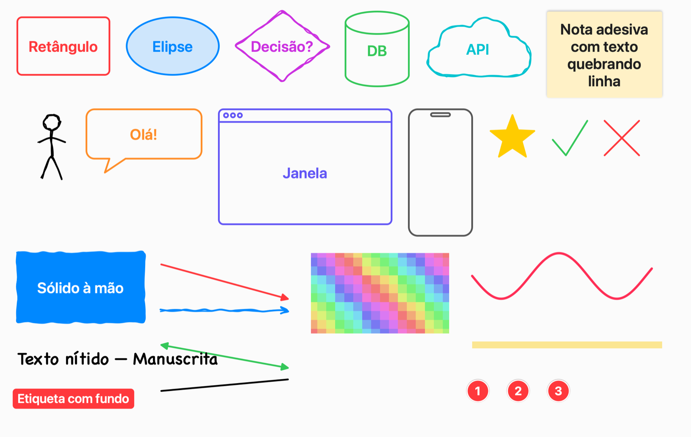

<div align="center">

# 📋 CopyPaste

**Histórico de cópias, captura de tela com anotações, quadro de apresentação e gravação de tela.**
**Tudo em um app nativo de barra de menus para macOS: leve, rápido e sem nada rodando à toa.**




<sub>Tudo o que você vê acima é desenhado pelo motor vetorial do app: formas, componentes no estilo Excalidraw, traço à mão, setas, passos numerados, desfoque, marca-texto e texto nítido.</sub>

</div>

---

## Sumário

- [Por que o CopyPaste?](#por-que-o-copypaste)
  - [As dores do Mac que o CopyPaste resolve](#-as-dores-do-mac-que-o-copypaste-resolve)
- [Recursos](#recursos)
  - [Histórico de cópias](#-histórico-de-cópias)
  - [Captura de tela](#-captura-de-tela)
  - [Modo apresentação (quadro)](#-modo-apresentação-quadro)
  - [Gravação de tela](#-gravação-de-tela)
- [Atalhos](#atalhos)
- [Instalação](#instalação)
- [Permissões](#permissões)
- [Compilando do código-fonte](#compilando-do-código-fonte)
- [Arquitetura](#arquitetura)
- [Desempenho e memória](#desempenho-e-memória)
- [Privacidade](#privacidade)
- [Solução de problemas](#solução-de-problemas)
- [Licença](#licença)

---

## Por que o CopyPaste?

O Mac é excelente, mas várias tarefas do dia a dia **simplesmente não existem no macOS**, ou exigem três apps diferentes, assinaturas pagas e muitos cliques. O CopyPaste junta tudo isso num app só, **nativo, gratuito, offline e leve**, com qualidade de app profissional.

### 🩹 As dores do Mac que o CopyPaste resolve

| # | A dor no macOS | Como o CopyPaste resolve |
|:-:|---|---|
| 1 | **O Mac só lembra a última coisa copiada.** Copiou outra coisa e a anterior sumiu para sempre. | **Histórico de cópias** com texto, links, código, cores, imagens e arquivos, busca, fixados e colagem direto no cursor (`⇧⌘V`). |
| 2 | **Anotar um print é um ritual:** `⇧⌘4`, esperar a miniatura, abrir a Marcação, editar, salvar, procurar o arquivo. | **Anota no lugar, na hora**: seta, texto, destaque, passos numerados e desfoque direto sobre a seleção, e `↩` copia. Sem janelas extras. |
| 3 | **A Mesa vira um depósito de "Captura de Tela 2026-…png".** | Por padrão, a captura vai **para a área de transferência**. Salvar só quando você quiser, numa pasta própria (`~/Pictures/CopyPaste`), em PNG ou JPG. |
| 4 | **Esconder senhas, e-mails ou dados de clientes** num print exige outro editor. | Ferramenta **Desfocar / ocultar** (`B`), que pixeliza a área em blocos grandes no próprio arquivo final (não é uma camada removível por cima). |
| 5 | **Copiar o texto de uma imagem, de um vídeo ou de um app que não deixa selecionar** é um sofrimento. | **OCR offline em português** (`⌘T`): selecione qualquer área da tela e o texto vai para a área de transferência. |
| 6 | **Descobrir a cor exata de um pixel** exige o escondido "Medidor de Cor Digital". | **Lupa com conta-gotas** na própria captura: `C` copia a cor em hex (`#1E90FF`). |
| 7 | **Precisa de uma referência na tela** (um layout, um trecho de código, uma tabela) enquanto trabalha em outra janela. | **Fixar na tela**: a captura vira uma janelinha flutuante por cima de tudo, com transparência ajustável. |
| 8 | **Não dá para desenhar na tela** durante uma reunião, aula ou gravação para apontar e explicar. | **Modo apresentação**: caneta, setas, laser e componentes por cima de qualquer app, com um modo que deixa os cliques passarem para os apps de baixo. |
| 9 | **Esboçar uma ideia ou um diagrama rápido** exige abrir o navegador ou outro app. | **Quadro instantâneo** (branco, quadriculado, escuro ou lousa) com componentes no estilo Excalidraw: notas, bancos de dados, pessoas, nuvens, janelas, celulares e traço à mão. |
| 10 | **A gravação nativa (`⇧⌘5`) não grava o som do Mac**, só o microfone. Gravar uma aula ou um tutorial com o som do vídeo vira gambiarra. | **Grava tela + microfone + áudio do Mac juntos**, com cliques destacados, por área ou tela inteira, codificado por hardware. |
| 11 | **Atalhos de captura do sistema são fixos e difíceis de lembrar** (`⇧⌘3`, `⇧⌘4`, `⇧⌘4` + `Espaço`, `⇧⌘5`…). | **Todos os atalhos são configuráveis**, inclusive com teclas F sozinhas (como a Print Screen de teclados externos), com aviso de conflito. |
| 12 | **As alternativas são pesadas, lentas ou pagas:** apps em Electron que travam ao abrir, ou assinaturas mensais. | **100% nativo em Swift**, sem dependências, ~50 MB em repouso, abre a captura em ~150 ms. **Gratuito e de código aberto.** |
| 13 | **Gerenciadores de clipboard podem guardar as suas senhas.** | **Ignora automaticamente** o que 1Password, KeeWeb e outros marcam como confidencial. Nada sai do seu Mac. |

### ⚖️ Comparado a ferramentas de captura comuns

Ferramentas como o Lightshot costumam **demorar para abrir**, deixam **texto borrado** e têm poucas ferramentas. Veja a diferença:

| | Ferramentas comuns | **CopyPaste** |
|---|---|---|
| Abrir a captura | Demora e às vezes trava | **A tela congela na hora** (~150 ms com 2 monitores) |
| Nitidez | Anotações rasterizadas | **Vetores** desenhados na resolução Retina |
| Ferramentas | Caneta, seta, retângulo | + marca-texto, passos numerados, desfoque, texto com fundo, **componentes**, traço à mão, laser |
| Janelas | Seleção manual | **Destaca a janela sob o mouse**; um clique captura só ela |
| Precisão | Sem lupa | **Lupa** com coordenadas e cor do pixel (copia o hex) |
| Texto da imagem | — | **OCR** offline, em português |
| Depois da captura | Copiar / salvar | + **fixar na tela**, **abrir no quadro**, **gravar a área**, Google Lens |
| Apresentação | — | **Quadro** sobre a tela ou em fundo branco, quadriculado, escuro ou lousa |
| Vídeo | — | **Gravação** de tela com microfone e áudio do Mac |
| Atalhos | Fixos | **Todos configuráveis**, com aviso de conflito |
| Consumo | Processo sempre ativo | **Nada fica rodando em segundo plano**: tudo é criado sob demanda e liberado ao fechar |

---

## Recursos

### 📋 Histórico de cópias

- Guarda **texto, links, código, cores, imagens e arquivos** copiados, com o ícone do app de onde vieram.
- **Painel rápido** (`⇧⌘V`) que abre junto ao cursor de texto, ao ponteiro do mouse ou no centro da tela.
- **Cola direto** onde está o cursor (com a permissão de Acessibilidade) ou só copia.
- **Biblioteca** completa com busca, filtros por tipo, fixados e mais usados.
- Itens **fixados** nunca expiram. Dá para escolher por quanto tempo guardar (de 1 hora a para sempre) e um limite de itens.
- **Ignora gerenciadores de senha**: conteúdo marcado como confidencial (1Password, KeeWeb etc.) nunca é salvo.
- Reconhece cores (`#FF8800`, `rgb(…)`) e mostra a amostra; detecta código pelo conteúdo e pelo app de origem.

### 📸 Captura de tela

1. Aperte o atalho e **a tela congela imediatamente**, em todos os monitores.
2. **Passe o mouse** sobre uma janela para destacá-la, e **clique** para capturá-la. Ou **arraste** para escolher uma área.
3. Anote, depois **copie** (`↩`), **salve** (`⌘S`) ou escolha outra ação.

**Seleção precisa**
- Lupa com zoom de pixels, coordenadas e cor (`C` copia a cor em hexadecimal).
- Setas do teclado movem o ponteiro 1 pixel por vez.
- `⇧` deixa a seleção quadrada, `F` ou `↩` seleciona a tela inteira.
- Depois de selecionar: alças para redimensionar, `⌘` + arrastar para mover a área (as anotações vão junto).
- O tamanho real em pixels aparece sempre acima da seleção.

**Ferramentas de anotação**

| Ferramenta | Tecla | Ferramenta | Tecla |
|---|:-:|---|:-:|
| Selecionar / mover / redimensionar | `V` | Texto (com ou sem fundo) | `T` |
| Caneta | `P` | Passo numerado ①②③ | `N` |
| Marca-texto | `H` | Desfocar / ocultar dados | `B` |
| Linha | `L` | Borracha | `E` |
| Seta | `A` | Nota adesiva | `S` |
| Retângulo | `R` | Losango | `D` |
| Elipse | `O` | Laser (apresentação) | `K` |

**Estilo:** 12 cores (`1`–`9` trocam rápido), 4 espessuras, preenchimento (nenhum, suave ou sólido), tracejado, **traço desenhado à mão** e 5 fontes (Sistema, Arredondada, Manuscrita, Serifada, Código) com tamanho ajustável.

**Edição:** desfazer e refazer ilimitados, `⌥` + arrastar duplica, `⇧` restringe linhas a 45° e formas a quadrado ou círculo, setas do teclado movem o item selecionado e duplo clique edita o texto.

**Ações após capturar**

| Ação | Atalho |
|---|:-:|
| Copiar | `↩` · `⌘C` · duplo clique |
| Salvar na pasta configurada | `⌘S` |
| Salvar como… | `⇧⌘S` |
| Copiar o texto da imagem (OCR, offline) | `⌘T` |
| Pesquisar a imagem no Google Lens | — |
| **Fixar na tela** (fica por cima das janelas; rolagem ajusta a transparência) | — |
| **Abrir no quadro** de apresentação | — |
| **Gravar vídeo** desta área | — |

### 🎨 Modo apresentação (quadro)

Desenhe **por cima de qualquer coisa na tela** durante uma reunião, aula ou gravação, ou use um quadro em branco.

- **Fundos:** transparente sobre a tela, quadro branco, quadriculado, escuro e lousa verde (`G` alterna).
- **Componentes no estilo Excalidraw:** nota adesiva, banco de dados, pessoa, nuvem, balão de fala, janela de navegador, celular, estrela, certo e errado, seta dupla, além de retângulo, elipse e losango.
- **Texto dentro dos componentes:** duplo clique em qualquer forma para escrever dentro dela, centralizado e com quebra de linha.
- **Laser:** um traço vermelho que some sozinho, para apontar sem sujar o quadro.
- **Modo interagir (`I`):** os cliques passam para os apps de baixo e o desenho continua visível. Volte a desenhar pelo atalho do quadro ou pela pílula no topo da tela.
- **Colar (`⌘V`):** imagens e textos da área de transferência viram itens do quadro.
- **Exportar:** copiar, salvar, salvar como ou fixar na tela. Com fundo transparente, a exportação inclui o que estava na tela, em Retina.
- O desenho **fica guardado** ao fechar o quadro, até você apagar.
- **Barra móvel:** arraste pela alça (☰) para onde quiser. Solte numa lateral e ela fica **vertical**; perto do topo ou da base, horizontal. Ela nunca fica atrás do notch da câmera e lembra a posição (duplo clique na alça volta ao padrão).

### 🎬 Gravação de tela

- Grave uma **área** ou a **tela inteira**. Clique numa janela para gravar só a região dela.
- **Microfone** e **áudio do Mac** (sons dos apps), cada um com seu botão.
- **Destaque dos cliques do mouse**; 24, 30 ou 60 quadros por segundo.
- Codificação por **hardware** (H.264 via ScreenCaptureKit), com pouco uso de CPU.
- Uma moldura vermelha marca a área gravada e **não aparece no vídeo**. Os desenhos do quadro **aparecem**, o que serve para gravar aulas e tutoriais.
- Durante a gravação, o ícone na barra fica vermelho com um cronômetro. Para parar, use o mesmo atalho ou o menu.
- O vídeo é salvo em `~/Movies/CopyPaste` e o Finder abre mostrando o arquivo.

> A gravação requer **macOS 15** ou mais recente. As demais funções rodam a partir do macOS 14.

---

## Atalhos

### Globais (configuráveis)

Em **Configurações › Atalhos globais**: clique no atalho e pressione a nova combinação. `⌫` desativa e `↺` volta ao padrão. Teclas F sozinhas (F13–F20, como a **Print Screen** de teclados externos) também valem. Se a combinação já pertencer a outra ação, o app avisa e desativa a outra.

| Ação | Padrão |
|---|:-:|
| Abrir histórico de cópias | `⇧⌘V` |
| Capturar área ou janela | `⇧⌘1` |
| Capturar tela inteira | `⇧⌘2` |
| Modo apresentação (quadro) | `⌥⇧⌘D` |
| Gravar tela (iniciar / parar) | `⌥⇧⌘R` |

> 💡 **Vindo do Lightshot?** Defina a captura de área como `F13`, a mesma tecla dele.
> ⚠️ Atalhos globais valem em **todos** os apps. Evite combinações como `⌘G` ou `⌘F`, que tirariam o "Buscar" dos outros programas.

### No painel de histórico

| Tecla | Ação |
|---|---|
| `↑` `↓` | Navegar |
| `↩` ou duplo clique | Colar onde está o cursor |
| `⌘↩` ou `⌘C` | Só copiar |
| `⌘1` … `⌘9` | Colar o item da posição |
| `Espaço` | Pré-visualizar |
| `⇥` / `⇧⇥` | Trocar filtro |
| `⌘P` | Fixar / desafixar |
| `⌘⌫` | Excluir item |
| `⌘L` | Abrir a biblioteca |
| `⎋` | Fechar |

### Na captura e no quadro

| Tecla | Ação |
|---|---|
| `V P H L A R O D T N S B E K` | Ferramentas |
| `1` … `9` | Trocar cor |
| `⌘Z` / `⇧⌘Z` | Desfazer / refazer |
| `⌫` | Apagar o item selecionado |
| `⌘D` · `⌥` + arrastar | Duplicar |
| `⌘A` | Selecionar tudo |
| `⇧` arrastando | 45°, quadrado, círculo |
| `⎋` | Desmarcar · fechar |
| `G` · `I` · `F` (quadro) | Fundo · interagir com a tela · trazer para frente |

---

## Instalação

### Pelo `.dmg`

1. Gere o instalador com `./package.sh`. Ele cria `dist/CopyPaste-<versão>.dmg` e um `.zip`.
2. Arraste o **CopyPaste** para **Aplicativos**.
3. Na primeira vez, clique com o botão direito no app, depois em **Abrir** e **Abrir** de novo. Se aparecer "está danificado":
   ```bash
   xattr -dr com.apple.quarantine /Applications/CopyPaste.app
   ```

### Direto do código

```bash
git clone git@github.com:jonathansfp/copypaste.git
cd copypaste
./install.sh   # compila, instala em /Applications e abre
```

O CopyPaste fica **só na barra de menus**, sem ícone no Dock. Na primeira execução ele abre as configurações e passa a iniciar com o Mac.

---

## Permissões

| Permissão | Para quê | Onde liberar |
|---|---|---|
| **Acessibilidade** | Colar automaticamente onde está o cursor | Ajustes › Privacidade e Segurança › Acessibilidade |
| **Gravação de Tela e Áudio do Sistema** | Capturar e gravar a tela | Ajustes › Privacidade e Segurança › Gravação de Tela |
| **Microfone** | Gravar a sua voz junto com a tela | O macOS pede na primeira gravação |

O status de cada permissão aparece em **Configurações**, com botões que levam direto ao lugar certo.

> Depois de liberar a Gravação de Tela, **feche e abra o CopyPaste**: o macOS só aplica a permissão para o app reaberto.

---

## Compilando do código-fonte

**Requisitos:** macOS 14+, Xcode 15+ (as macros do SwiftUI precisam do Xcode completo, não só das Command Line Tools).

```bash
./build.sh     # gera build/CopyPaste.app (universal: Apple Silicon + Intel)
./install.sh   # compila, instala em /Applications e abre
./package.sh   # gera dist/CopyPaste-<versão>.dmg e .zip
```

O `build.sh` usa o Xcode mesmo que o `xcode-select` aponte para as Command Line Tools.

### Assinatura (importante para as permissões)

O macOS prende as permissões de privacidade à **assinatura** do app:

- Com um certificado **Apple Development** ou **Developer ID** no Keychain (o Xcode cria um ao entrar com sua conta Apple), o `build.sh` assina com ele automaticamente. Assim **as permissões continuam valendo depois de recompilar**.
- Sem certificado, o app é assinado só localmente ("ad-hoc"), e o macOS **pede as permissões de novo a cada compilação**.
- Para escolher a identidade: `SIGN_IDENTITY="Developer ID Application: …" ./build.sh`.

### Autoteste de desenho

```bash
build/CopyPaste.app/Contents/MacOS/CopyPaste --selftest /tmp/teste.png
```

Desenha todas as formas e estilos num PNG e confere a detecção de cliques e o desfazer/refazer. A imagem no topo deste README é gerada assim.

---

## Arquitetura

App 100% nativo em **Swift**, com **AppKit + SwiftUI**, sem dependências externas. Usa só frameworks do sistema:
**ScreenCaptureKit** (captura e gravação), **CoreGraphics / CoreImage** (desenho e desfoque), **Vision** (OCR), **Carbon** (atalhos globais, sem precisar de Acessibilidade) e **ServiceManagement** (iniciar com o Mac).

```
Sources/CopyPaste/
├── main.swift, AppDelegate.swift      # Ciclo de vida, menu da barra, janelas
├── HotKeyManager.swift                # Atalhos globais (Carbon) por ação
├── Settings.swift, SettingsView.swift # Preferências e tela de configurações
├── ClipboardStore.swift, ClipItem.swift, QuickPanel.swift, LibraryView.swift, PasteService.swift
│                                      # Histórico de cópias, painel rápido, biblioteca, colar
├── Canvas/                            # Motor de desenho vetorial (captura + quadro)
│   ├── Shapes.swift                   #   Formas, estilos, renderização, traço à mão
│   ├── CanvasModel.swift              #   Estado, seleção, desfazer/refazer
│   ├── CanvasView.swift               #   Interação: criar, mover, redimensionar, editar texto, laser
│   └── CanvasUI.swift                 #   Barras de ferramentas e painel de estilo (SwiftUI)
├── Capture/                           # Captura de tela
│   ├── ScreenGrabber.swift            #   Congelamento via ScreenCaptureKit, janelas, exportação
│   ├── CaptureController.swift        #   Seleção, lupa, alças, barras, renderização final
│   └── CaptureExtras.swift            #   Aviso rápido (toast), OCR, janela fixada
├── Board/BoardController.swift        # Modo apresentação / quadro
├── Recording/ScreenRecorder.swift     # Gravação de tela + áudio
├── Diag.swift                         # Log de diagnóstico e --diagnose
└── SelfTest.swift                     # --selftest
```

**Como a captura funciona**
1. O atalho dispara o `CaptureController`, que pede ao ScreenCaptureKit uma imagem de cada monitor, em resolução Retina e sem cursor.
2. Cada monitor ganha uma janela sem bordas que mostra a imagem congelada numa camada da GPU. Por cima dela fica o `CaptureCanvasView`, que desenha o escurecimento, a seleção e as anotações.
3. As anotações são **vetores** (`Shape`). Ao copiar ou salvar, o recorte da imagem original é combinado com as formas desenhadas na resolução real dos pixels, por isso o texto e as setas ficam perfeitamente nítidos.
4. Ao fechar, janelas, imagens e o modelo são liberados.

---

## Desempenho e memória

- **Em repouso:** ~50 MB. Só o monitor da área de transferência roda, uma checagem leve a cada 0,4 s.
- **Captura:** abre em ~150 ms com 2 monitores Retina. A memória sobe enquanto ela está aberta (as telas ficam em resolução total) e é devolvida ao fechar, sem vazamento em capturas repetidas.
- **Desenho:** só as formas são redesenhadas a cada movimento; a imagem congelada fica numa camada da GPU.
- **Gravação:** codificação por hardware, sem cópia de quadros pelo app.

---

## Privacidade

- **Nada sai do seu Mac.** Não há rede, telemetria nem conta. O OCR roda localmente pelo Vision.
- O histórico fica em `~/Library/Application Support/CopyPaste/`.
- Conteúdo marcado como confidencial por gerenciadores de senha **nunca é salvo**.
- A única ação que abre algo na internet é **Pesquisar no Google Lens**, e só quando você clica: ela abre o navegador e a imagem fica copiada para você colar.

---

## Solução de problemas

<details>
<summary><b>O atalho de captura não faz nada ou o app fica pedindo "Abrir Ajustes"</b></summary>

Quase sempre é a permissão de **Gravação de Tela** presa a uma assinatura antiga do app (aparece ligada em Ajustes, mas o macOS nega). Para resolver:

```bash
tccutil reset ScreenCapture local.copypaste.app
tccutil reset AudioCapture local.copypaste.app
```

Depois feche e abra o CopyPaste, aperte o atalho, libere quando o macOS pedir e clique em **Sair e Reabrir**. Para isso não voltar a acontecer, compile com um certificado estável (veja [Assinatura](#assinatura-importante-para-as-permissões)).
</details>

<details>
<summary><b>O atalho aparece em vermelho ("já é usado por outro app")</b></summary>

Outro programa registrou a mesma combinação (por exemplo, o Lightshot com `F13`). Feche o outro app ou escolha outra combinação em Configurações.
</details>

<details>
<summary><b>Não cola sozinho, só copia</b></summary>

Libere o CopyPaste em **Ajustes › Privacidade e Segurança › Acessibilidade**.
</details>

<details>
<summary><b>Como ver o que está acontecendo por dentro?</b></summary>

O app mantém um log curto (até ~200 KB) em:

```
~/Library/Application Support/CopyPaste/diagnostico.log
```

Ele registra os atalhos (se foram registrados e quando dispararam), o estado das permissões e os erros de captura ou gravação. Para testar só a permissão e a captura:

```bash
open -n /Applications/CopyPaste.app --args --diagnose
# e para salvar também uma imagem da tela principal:
open -n /Applications/CopyPaste.app --args --diagnose --save /tmp/tela.png
```
</details>

---

## Licença

Distribuído sob a licença **GNU GPL v3.0**. Veja [`LICENSE`](LICENSE).

<div align="center"><sub>Feito com Swift, para quem copia, captura e explica coisas o dia inteiro.</sub></div>
